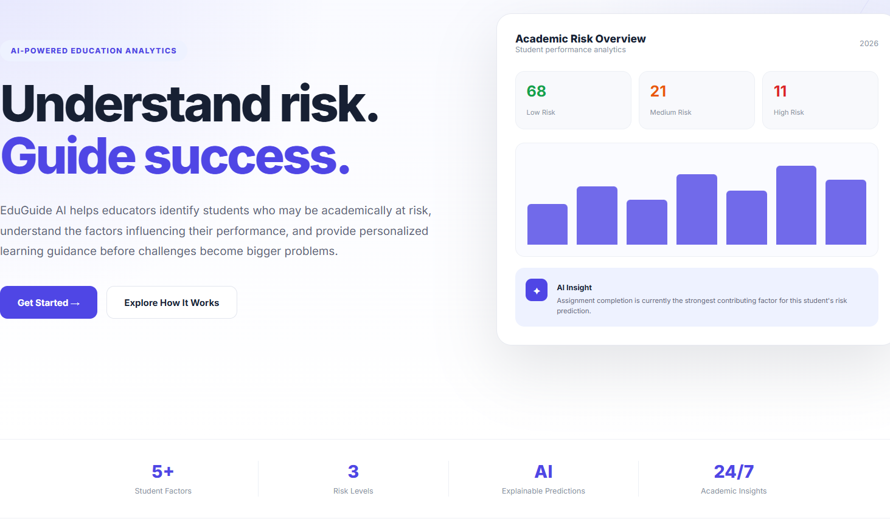
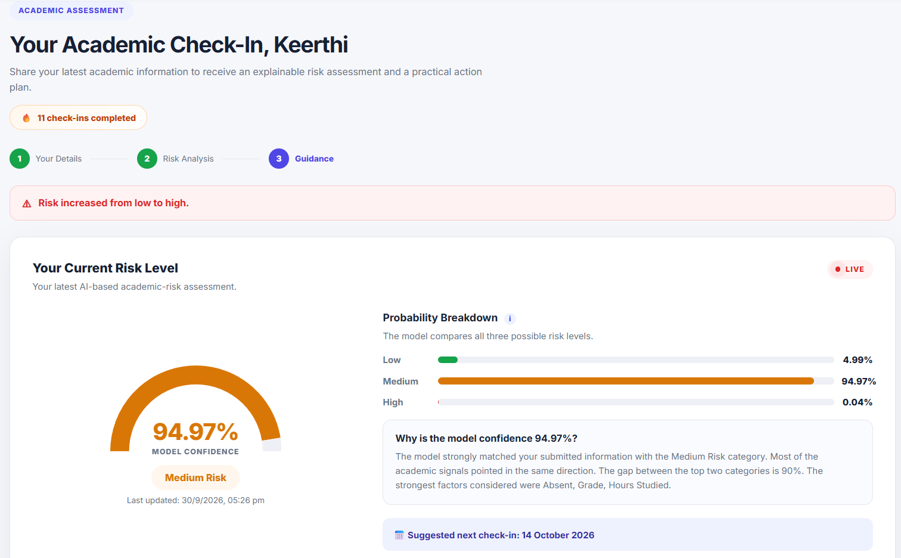
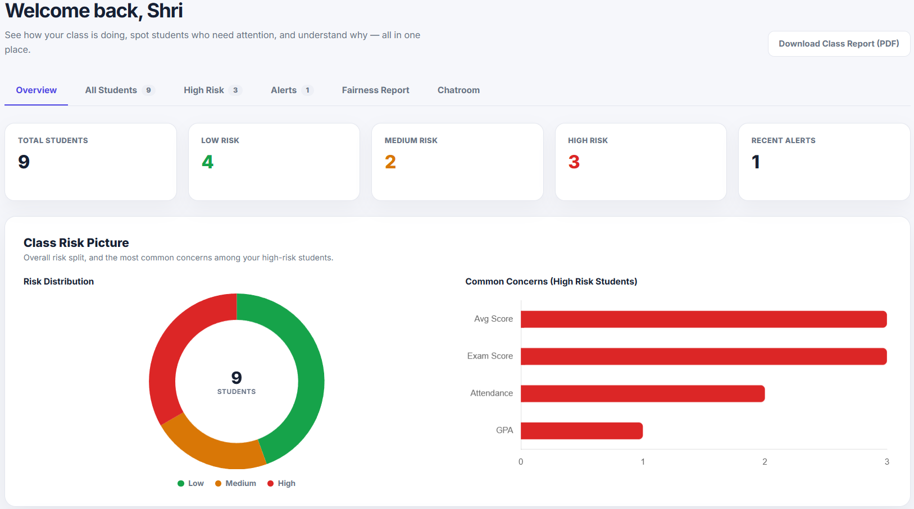
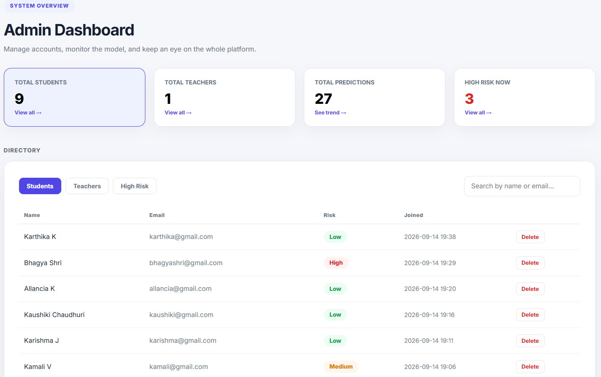
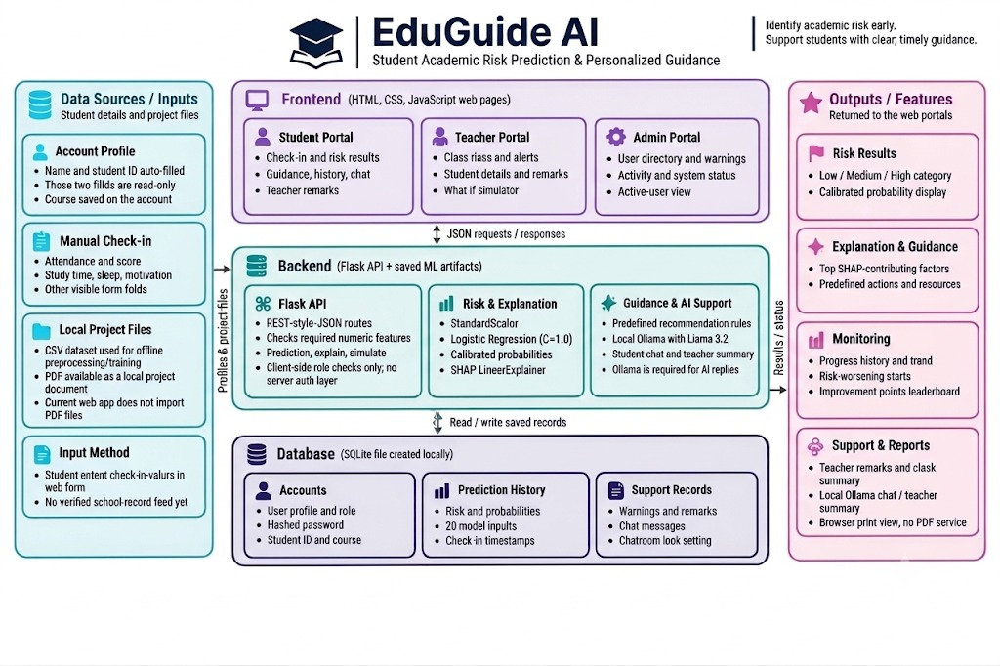
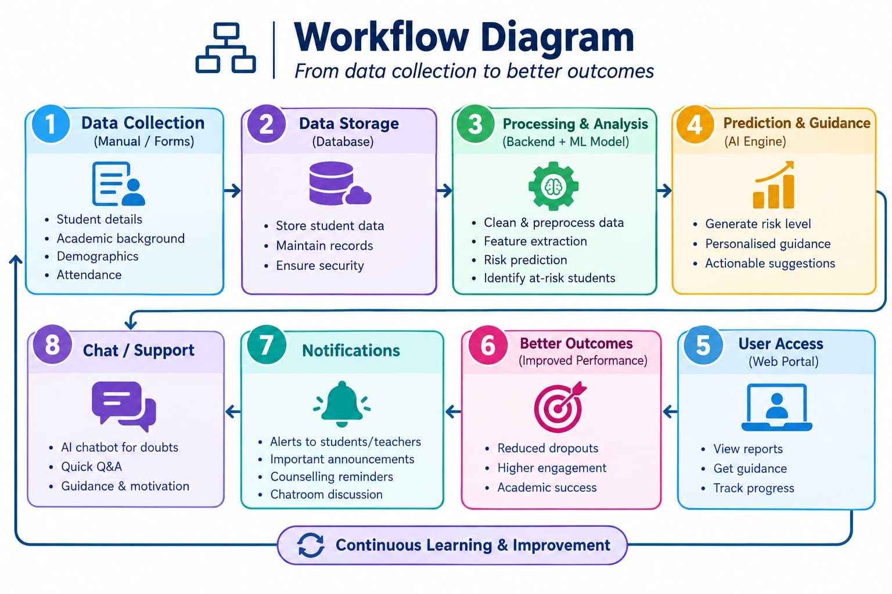

<h1 align="center">EduGuide AI</h1>

<p align="center">
  An explainable early-warning platform that predicts academic risk, shows why, and guides students and teachers.
</p>

<p align="center">
  
  
  
  
  
  
  
</p>

<p align="center">
  <b>Predict</b> who is at academic risk &nbsp;·&nbsp; <b>Explain</b> why &nbsp;·&nbsp; <b>Guide</b> what to do next &nbsp;·&nbsp; <b>Monitor</b> progress over time
</p>

---

## Table of contents

- [About the project](#about-the-project)
- [Key features](#key-features)
- [Screenshots](#screenshots)
- [How it works](#how-it-works)
- [Model results](#model-results)
- [Responsible AI](#responsible-ai)
- [Tech stack](#tech-stack)
- [Project structure](#project-structure)
- [Getting started](#getting-started)
- [API overview](#api-overview)
- [Limitations and future work](#limitations-and-future-work)
- [Author](#author)
- [License and acknowledgements](#license-and-acknowledgements)

## About the project

Most students who fall behind are noticed only after the exam results arrive. **EduGuide AI** is an early-warning platform that spots the pattern sooner. A student enters a few academic details, and the system:

1. **Predicts** a risk level: low, medium or high.
2. **Explains** which factors pushed the result, using SHAP, so the prediction is never a black box.
3. **Guides** the student with a personal action plan, and lets them ask a local AI assistant follow-up questions.
4. **Monitors** progress across check-ins and raises an alert when risk suddenly gets worse.

Teachers see the whole class at a glance with plain-language summaries. Administrators see live system activity. The whole project runs on a single laptop with free tools, and the chatbot needs no API key.

## Key features

| For students | For teachers | For administrators |
| --- | --- | --- |
| Risk gauge with low, medium and high probabilities | Class overview with searchable, sortable student table | User directory with search and role tabs |
| SHAP chart: why am I at this risk level? | High-risk "Needs Attention" list, most serious first | Issue warnings to students, delete accounts |
| Action plan: immediate actions, short-term goals, resources | Alerts when a student's risk just increased | Model and fairness summary card |
| Progress chart with trend and next check-in date | AI-written summary for each student, aimed at the teacher | Predictions-over-time chart |
| Improvement leaderboard that rewards progress only | What-if simulator: move attendance, score and study hours | Live activity feed and system status checks |
| Local AI chatbot grounded in the student's real results | Send remarks to students, moderate the class chatroom | Admin accounts created only by a setup script |
| Class chatroom and teacher remarks | Printable student report | |

## Screenshots

<table>
  <tr>
    <td width="50%"><br><sub><b>Landing page</b>: what EduGuide does and how it works</sub></td>
    <td width="50%"><br><sub><b>Student results</b>: risk gauge, SHAP reasons, action plan</sub></td>
  </tr>
  <tr>
    <td width="50%"><br><sub><b>Teacher dashboard</b>: class table, alerts, student panel</sub></td>
    <td width="50%"><br><sub><b>Admin dashboard</b>: users, activity feed and system status</sub></td>
  </tr>
</table>

## How it works

<p align="center">
  
</p>

<p align="center">
  
</p>


1. The student fills in the check-in form. The page converts the answers into the 20 numbers the model was trained on.
2. The Flask backend validates the input and scales it with the saved `StandardScaler`.
3. A Logistic Regression model predicts the risk level. A calibrated copy supplies realistic percentages.
4. `shap.LinearExplainer` measures how much each factor pushed toward the predicted level.
5. A recommendation engine turns the top three factors into an action plan.
6. The result is saved to SQLite, so progress and alerts can be calculated from the last two check-ins.
7. A local Llama 3.2 model (through Ollama) rewrites the advice in simple words, one tone for students and another for teachers.

## Model results

Dataset: **8,500 students, 22 columns**, no missing values, split 80% training (6,800 rows) and 20% testing (1,700 rows), keeping the same class mix. About 77% of students are medium risk, 12% low and 10% high, so accuracy alone can hide a weak model. These are the results from the final training run:

| Model | Accuracy | High-risk students caught |
| --- | --- | --- |
| **Logistic Regression (chosen)** | 95.82% | **94% (166 of 176)** |
| XGBoost | **96.24%** | 88% (155 of 176) |
| Random Forest (200 trees) | 94.65% | 82% (144 of 176) |
| Decision Tree | 93.41% | 83% (146 of 176) |

**Why not the most accurate model?** XGBoost scores slightly higher on accuracy, but Logistic Regression missed 10 high-risk students where XGBoost missed 21. In an early-warning system, missing a struggling student costs more than a small drop in accuracy, so the model was chosen for high-risk recall. The test set holds only 176 high-risk students, so the 11-student gap is modest.

## Responsible AI

- **Explainable:** every prediction comes with its top contributing factors. Across the dataset, absence, GPA, attendance, exam score and previous scores matter most.
- **Fairness check:** `/fairness-report` compares risk by gender. High-risk rate is 10.6% for female and 10.1% for male students, and `gender` and `age` rank near the bottom of the SHAP importance list.
- **Privacy basics:** passwords are hashed, admin accounts cannot be created through sign-up, and students never see another student's scores or risk level.
- **Decision support, not a verdict:** the output is guidance for people, and it is labelled as AI-generated on every dashboard.

## Tech stack

| Layer | Tools |
| --- | --- |
| Backend | Python, Flask, Flask-CORS, Flask-SQLAlchemy, SQLite, Werkzeug |
| Machine learning | pandas, NumPy, scikit-learn, XGBoost (comparison only), SHAP, joblib |
| AI assistant | Ollama running Llama 3.2 locally, free and no API key |
| Frontend | HTML, CSS, JavaScript, Chart.js 4.4.0, Inter font |
| Testing and tooling | Postman, Git and GitHub |

## Project structure

```text
EduGuide-AI/
├── data/
│   ├── raw/students.csv               original dataset, never edited
│   └── processed/                     encoded dataset
├── src/
│   ├── inspect_data.py                data checks
│   ├── preprocess.py                  label encoding
│   ├── train_model.py                 trains and compares four models
│   └── explain_model.py               SHAP analysis
├── models/                            saved model, scaler and encoders
├── database/                          SQLite file (created locally, not tracked)
├── backend/
│   ├── app.py                         Flask API
│   ├── models_db.py                   database tables
│   └── create_admin.py                one-time admin account setup
├── docs/images/                       README images
├── index.html                         landing page, login and sign-up
├── student-dashboard.html
├── teacher-dashboard.html
├── admin-dashboard.html
├── requirements.txt
└── LICENSE
```

## Getting started

**You need:** Windows with PowerShell, Python 3, Git, and [Ollama](https://ollama.com) for the chatbot and teacher summaries.

```powershell
# 1. Get the code
git clone https://github.com/Keerthi01-tech/EduGuide-AI.git
cd EduGuide-AI

# 2. Create and activate a virtual environment
py -m venv .venv
.\.venv\Scripts\Activate.ps1

# 3. Install the libraries
python -m pip install --upgrade pip
pip install -r requirements.txt

# 4. Prepare the data and train the model
python src\preprocess.py
python src\train_model.py

# 5. Create the database folder (safe to run if it already exists)
New-Item -ItemType Directory -Force database

# 6. Download the local AI model (one time)
ollama pull llama3.2

# 7. Create an admin account (one time)
python backend\create_admin.py

# 8. Start the backend (leave this window open)
python backend\app.py
```

Open a **second** PowerShell window in the same folder and serve the pages:

```powershell
python -m http.server 5500
```

Then visit **http://localhost:5500/index.html**. The backend runs at `http://127.0.0.1:5000`.

<details>
<summary><b>Troubleshooting</b></summary>

- **Windows blocks SciPy ("Application Control policy has blocked this file"):** keep the project outside OneDrive, for example `C:\Projects\EduGuideAI`, and create a fresh `.venv` there.
- **PowerShell will not activate the environment:** run `Set-ExecutionPolicy -Scope Process Bypass`, then activate again.
- **Dashboards show no data:** the Flask backend is not running.
- **Chatbot or teacher summary fails:** start Ollama and make sure `ollama pull llama3.2` has finished.
- **Harmless warnings:** SHAP's "background has 8500 samples", scikit-learn's "no valid feature names" and SQLAlchemy's "Query.get is legacy".
</details>

## API overview

| Area | Endpoints |
| --- | --- |
| Accounts | `POST /register`, `POST /login` |
| Prediction | `POST /predict`, `POST /explain`, `POST /recommendations`, `POST /simulate` (what-if, never saved) |
| Student | `GET /student/progress/<id>`, `GET /student/alerts/<id>`, `GET /student/profile/<id>`, `GET /student/remarks/<id>`, `GET /leaderboard/<id>` |
| Assistant | `POST /chat` |
| Teacher | `GET /teacher/students`, `GET /teacher/student/<id>`, `GET /teacher/high-risk`, `GET /teacher/alerts`, `POST /teacher/remarks` |
| Chatroom | `GET` and `POST /chatroom/messages`, `POST /chatroom/lock` |
| Responsible AI | `GET /fairness-report` |
| Admin | `GET /admin/overview`, `/admin/users`, `/admin/user/<id>`, `/admin/predictions-timeline`, `/admin/system-status`, `/admin/activity-feed`, `POST /admin/users/<id>/warn`, `DELETE /admin/users/<id>` |

## Limitations and future work

**Known limitations**

- Students type their own numbers, so a student could enter false values. A verified **Student Records** table that teachers or administrators maintain is the planned fix.
- The test set contains only 176 high-risk students, and 77% of the data is the medium class.
- The model was trained on one dataset, and the 20 inputs are simplified into the form fields.
- The Terms of Service and Privacy Policy are samples for a college project and have not been reviewed by a lawyer.
- The chatbot and teacher summaries need Ollama running on the same machine.

**Future work:** verified student records, saving department and year at sign-up, a public transparency page for the fairness report, deployment with a fallback when Ollama is unavailable, and a live link to a real school attendance and marks system.

## Author

**Keerthi Shri G**: third-year Computer Science and Engineering student.
Email: [keerthishri2004@gmail.com](mailto:keerthishri2004@gmail.com) · GitHub: [@Keerthi01-tech](https://github.com/Keerthi01-tech)

## License and acknowledgements

Released under the [MIT License](LICENSE).

Built with [Flask](https://flask.palletsprojects.com), [scikit-learn](https://scikit-learn.org), [SHAP](https://github.com/shap/shap), [Chart.js](https://www.chartjs.org) and [Ollama](https://ollama.com). The AI assistant uses Meta's Llama 3.2 under its community licence.

<p align="center"><sub>If this project helped you, consider giving it a star.</sub></p>